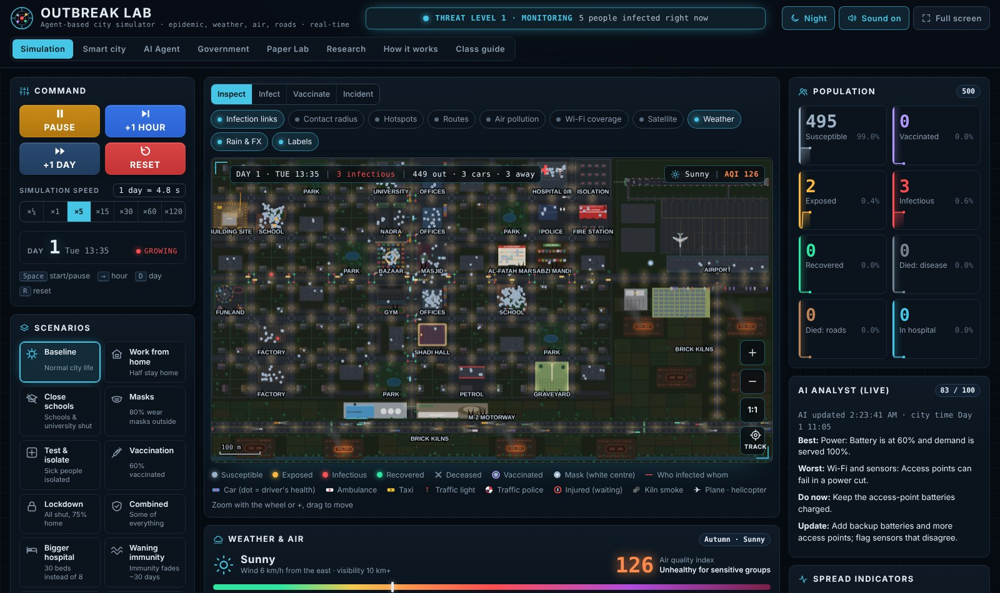
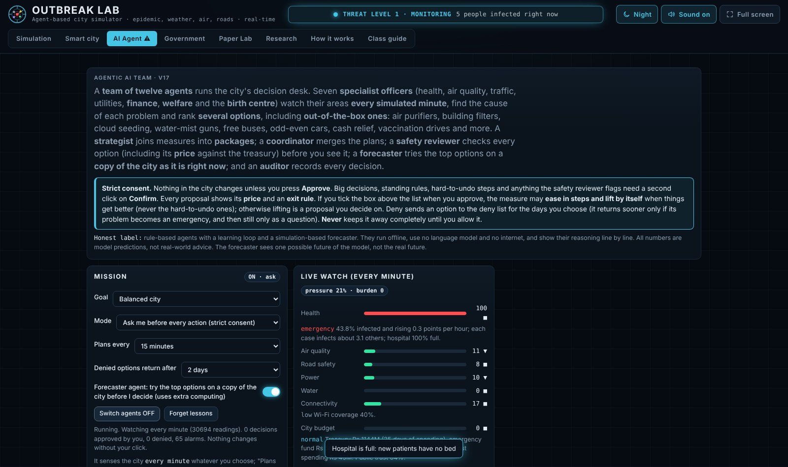

# 🦠 Outbreak Lab

**An agent-based smart-city simulator that runs entirely in the browser.**

500 simulated people live, work, pray, shop and travel in a small city. An epidemic, the weather, air pollution, traffic and city infrastructure all play out on top of their daily routines, minute by minute. A team of rule-based AI agents watches the city and proposes measures, but nothing changes until a human approves it.

[](LICENSE)
[](package.json)
[](package.json)
[](#-quick-start)

**[▶ Live demo](https://asad-mashood.github.io/outbreak-lab/)** · [Architecture](docs/ARCHITECTURE.md) · [How the agents decide](docs/AGENTIC_AI.md) · [Model](docs/MODEL.md) · [Changelog](CHANGELOG.md)



---

## ✨ What it simulates

| Area | What is inside |
| --- | --- |
| 🧫 **Epidemic** | Susceptible, Exposed, Infectious, Recovered, Vaccinated and Deceased states, with a hospital, isolation ward, testing, masks, lockdown and waning immunity. |
| 🏙️ **A living city** | Offices, schools, a university, factories, a bazaar, a masjid, parks, a gym, an airport, a motorway and a brick-kiln belt on a 1 km × 0.6 km map. |
| 🌦️ **Weather and air** | Seasons, rain, fog, storms, snow and a live air-quality index driven by traffic and kiln smoke. |
| ⚡ **Smart-city layer** | Power grid with solar and battery, water network, waste collection, buses, ambulances, fire engines, Wi-Fi and sensors. |
| 🔗 **Coupled systems** | A power cut stops the pumps, a water shortage hurts hygiene, and poor hygiene raises infections at home. |
| 🏛️ **Government** | Treasury, departmental budgets, prices, households and public trust. |
| 🧪 **Paper Lab** | Design a multi-seed experiment, compare scenarios and build a draft write-up from the results. |

Nothing in the outcome is scripted. Each person has a home, a family, a job or school and a daily plan. Infection passes when people share a place, so the epidemic curve **emerges** from behaviour instead of being drawn from an equation.

---

## 🤖 What "agentic" means, and how this project is agentic

An **agentic** system does more than answer a question. It keeps watching a situation, decides what to do in pursuit of a goal, and takes action, usually with a person still in control. The useful parts are a loop (sense, decide, act, check the result) and clear limits on what the system may change on its own.

Outbreak Lab's AI team follows that loop:

| Agentic property | What the agents do here | Where it lives |
| --- | --- | --- |
| **Perceives** | Reads the city every simulated minute and turns it into nine pressures from 0 to 1: health, air, roads, power, water, connectivity, budget, household hardship and maternal care. | `observe()` in `js/mayor.js` |
| **Pursues a goal** | You pick what matters most (balanced, lives, air or infrastructure). The goal sets how the pressures are weighted. | `GOALS` |
| **Plans** | Scores 83 possible measures by urgency, cost to people, learned trust and budget. Seven specialist officers propose plans, and a coordinator merges them. | `options()`, `deliberate()` |
| **Forecasts before acting** | The top options are tried on a copy of the city that uses the same random future, so differences come from the option and not from chance. | `pumpForecasts()` |
| **Asks before acting** | Nothing changes unless you press **Approve**. Big or hard-to-undo decisions need a second confirmation. Denied options stay off the list for a chosen number of days. | `propose()`, `approve()`, `act()` |
| **Reviews its own proposals** | A safety reviewer attaches cautions, such as a restriction that hits daily-wage workers, and flags sensor readings that may be wrong. | `review()` |
| **Learns from outcomes** | After a set window, it compares what happened with what the trend alone predicted, and trusts measures that helped more. | `reflect()`, `lessons` |
| **Keeps a record** | Every decision is written to a ledger, so you can read why the agents did what they did. | `led()` |



**The honest label.** These agents are **rule-based**, not language models. They run offline, make no network calls and use no AI model to write text. Every score is arithmetic you can read in the code. The "learning" is a simple trust table that changes from past results. This makes the behaviour easy to test and explain, and it means the agents can be wrong in ways you can trace.

For the full walk-through of the loop, see [docs/AGENTIC_AI.md](docs/AGENTIC_AI.md).

---

## 🚀 Quick start

No build step and no dependencies.

```bash
git clone https://github.com/asad-mashood/outbreak-lab.git
cd outbreak-lab
# open index.html in a browser (double-click it), or:
python -m http.server 8000      # then visit http://localhost:8000
```

Prefer one file? `node tools/build.js` writes `dist/outbreak-lab.html`, a self-contained copy that works offline.

### Run it headless (Node 18+)

```bash
node bench/bench.js data/results.json 5 3   # 4 scenarios x 7 controllers x 5 seeds
node bench/make_paper.js                    # results -> docs/paper-draft.md
node tools/export-data.js                   # code constants -> data/*.json
```

### Keyboard shortcuts

| Key | Action |
| --- | --- |
| `Space` | Start / pause |
| `→` | Advance one hour |
| `D` | Advance one day |
| `R` | Restart with current settings |
| `N` | Map lighting: night / day / auto |
| `M` | Sound on / off |
| `F` | Full screen |

---

## 🗂️ Project layout

```
index.html          page and in-app documentation
css/styles.css      styles
js/model.js         the city model: people, traffic, weather, air, utilities
js/econ.js          economy, government, birth centre
js/mayor.js         the agentic AI team, forecaster, benchmark runner
js/paper.js         statistics and paper builder
js/app.js           graphics and controls
js/agent-ui.js, gov-ui.js, paperlab-ui.js   the three analysis tabs
bench/              headless benchmark and paper generator
tools/              single-file build, data export
data/               JSON/CSV: parameters, city, 83 agent measures, results
docs/               ARCHITECTURE.md, AGENTIC_AI.md, MODEL.md, paper draft
papers/             two research documents linked from the Research tab
```

Start with [docs/ARCHITECTURE.md](docs/ARCHITECTURE.md), then [docs/AGENTIC_AI.md](docs/AGENTIC_AI.md) for how the agent team decides.

**Reproducibility.** One tick is one simulated minute. Random numbers are seeded, so any run can be repeated exactly. See [CHANGELOG.md](CHANGELOG.md) for what changed in each version.

---

## ⚠️ Limitations

This is a teaching and exploration model. It has **not** been calibrated against a real city, so its numbers describe the simulator, not the real world. Do not use it for real public-health or policy decisions.

---

## 👤 Author

**Muhammad Asad Mashood**, BS Artificial Intelligence, COMSATS University Islamabad, Wah Campus.
[GitHub](https://github.com/asad-mashood) · [LinkedIn](https://www.linkedin.com/in/muhammad-asad-mashood-6ba728352)


## 📄 License

The code is released under the [MIT License](LICENSE). The documents in `papers/` are © the author, all rights reserved.
